<div align="center">

# PREVEN<span>ZA</span>

### See heat-health risk building before it becomes harm.

**An explainable, privacy-preserving early-warning system for population & workforce health**
Future Health Digital Innovation Challenge · Team **Double A**

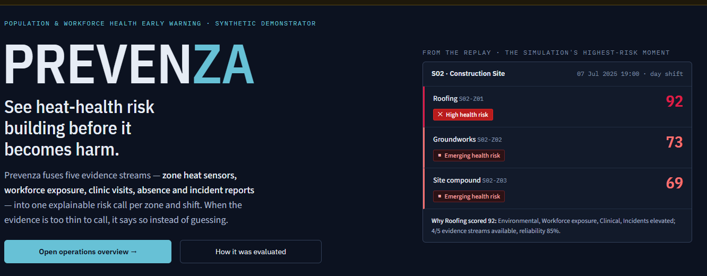

</div>

> [!WARNING]
> **Synthetic demonstrator.** Every number in this repository comes from simulated data. Prevenza has not been
> clinically validated and must not be used for real-world medical, occupational-health or emergency decisions.

---

## Why Prevenza

Early signs of a workforce heat-health problem never sit in one dataset. The temperature rises in a zone; a few more
workers visit the clinic; absence ticks up two days later; an incident report mentions dehydration. Reviewed separately
and after the fact, the pattern stays invisible until people are already hurt.

**Prevenza fuses five evidence streams into one explainable risk call per zone and shift** — and says plainly when the
evidence is too thin to call.

| Stream | Signal | Arrives |
|---|---|---|
| 🌡️ Environmental | zone temperature, humidity, NWS heat index | minutes |
| 👷 Workforce exposure | workers present, hours in the heat | ~2 h |
| 🩺 Clinical | aggregated heat-related clinic visits | ~1 day |
| 📅 Absenteeism | unplanned absence rate | ~2 days |
| ⚠️ Incidents | heat-related incident severity counts | ~1 day |

## The use case, in one screen

> *A safety manager oversees three industrial sites during a July heatwave. At 19:00 on 7 July the zone board lights
> up: **Roofing** at the construction site is a **High health risk at 92/100**, two neighbouring zones are **emerging**,
> and the board already flags that absenteeism data is **stale** and one heat-index reading is **extrapolated**.*

<div align="center">
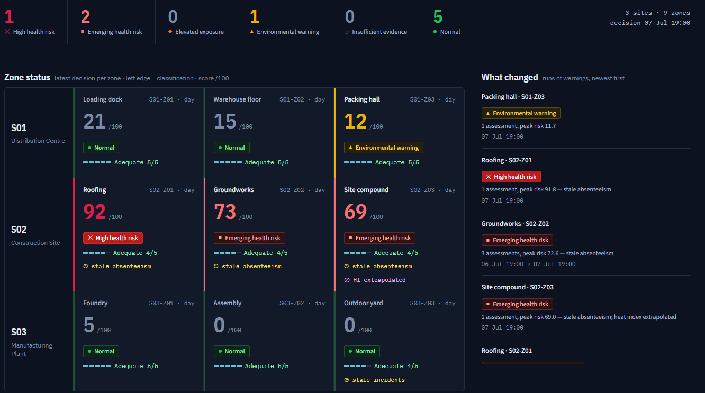
</div>

## What's inside the app

`streamlit run app.py` opens a read-only, seven-page decision-support app (deep links: `?page=home|overview|monitoring|alerts|forecasting|evaluation|data-quality`, plus `&asof=2025-07-07T19:00` to replay a moment).

| Page | What you can do |
|---|---|
| **Home** | The story, live product specimen, how it works, principles and honest results |
| **Executive overview** | Replay any decision time · status ledger · 3×3 zone status board · "what changed" feed · zone × day risk matrix |
| **Site & zone monitoring** | Fused risk trajectory · thermal reading on NWS heat bands · day/night classification tiles · five synchronised evidence streams · raw measurements with gaps, never zeros |
| **Alert investigation** | Every alert episode · evidence at first detection · points contributed per category · full explanation · illustrative (non-medical) actions |
| **24-hour forecasting** | Ranking score beside the persistence baseline · eligibility · imputed inputs · missing & stale sources |
| **Model evaluation** | Backtests against ground truth on identical out-of-sample windows · confusion matrices · lead-time dumbbell · audit findings |
| **Data quality & reliability** | Valid / missing / stale / invalid / insufficient evidence · latency · staleness · reliability distribution |

### A tour of the app

<table>
<tr>
<td width="50%" valign="top">
<b>🔎 Site &amp; zone monitoring</b><br>
<sub>Risk trajectory, thermal reading on NWS heat bands, day/night tiles and five synchronised evidence streams.</sub><br><br>
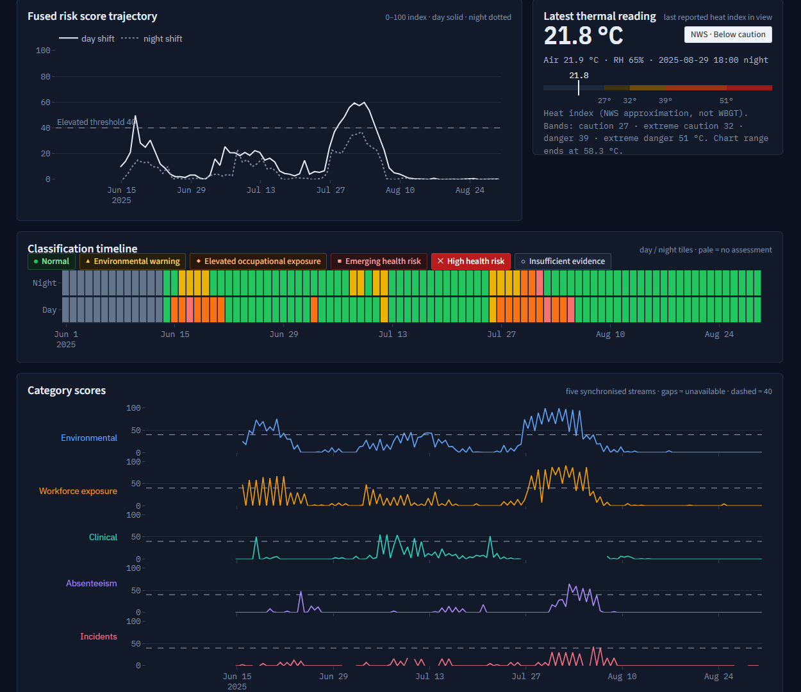
</td>
<td width="50%" valign="top">
<b>🚨 Alert investigation</b><br>
<sub>Every alert episode, the evidence at first detection and how each category moved the score.</sub><br><br>
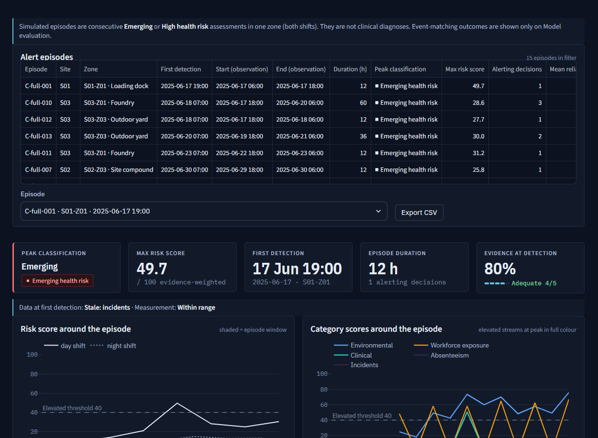
</td>
</tr>
<tr>
<td width="50%" valign="top">
<b>📈 24-hour forecasting</b><br>
<sub>Uncalibrated ranking beside the persistence baseline, with eligibility and data caveats.</sub><br><br>
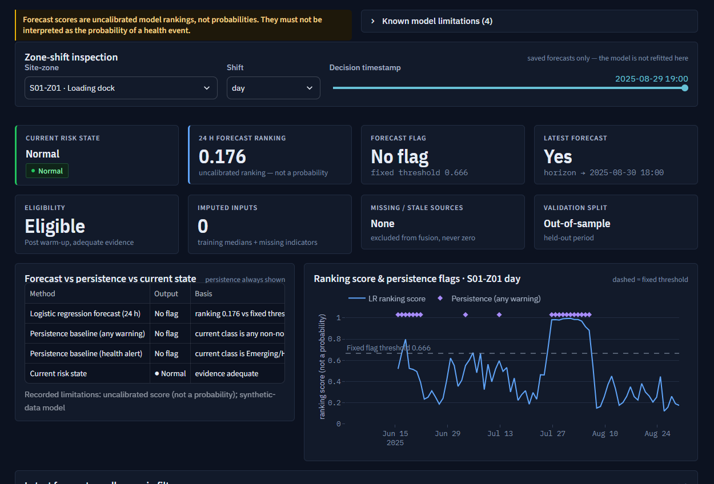
</td>
<td width="50%" valign="top">
<b>⚖️ Model evaluation</b><br>
<sub>Direction-aware benchmark table and confusion matrices on identical out-of-sample rows.</sub><br><br>
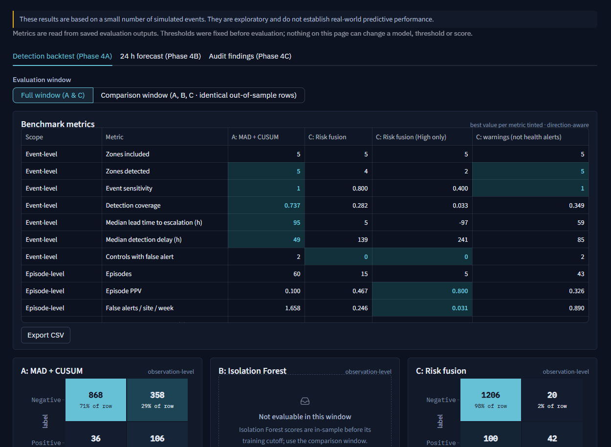
</td>
</tr>
<tr>
<td colspan="2" valign="top">
<b>🧪 Data quality &amp; reliability</b><br>
<sub>Missing ≠ zero, missing ≠ normal: availability, missingness, latency and the five data states made visible.</sub><br><br>
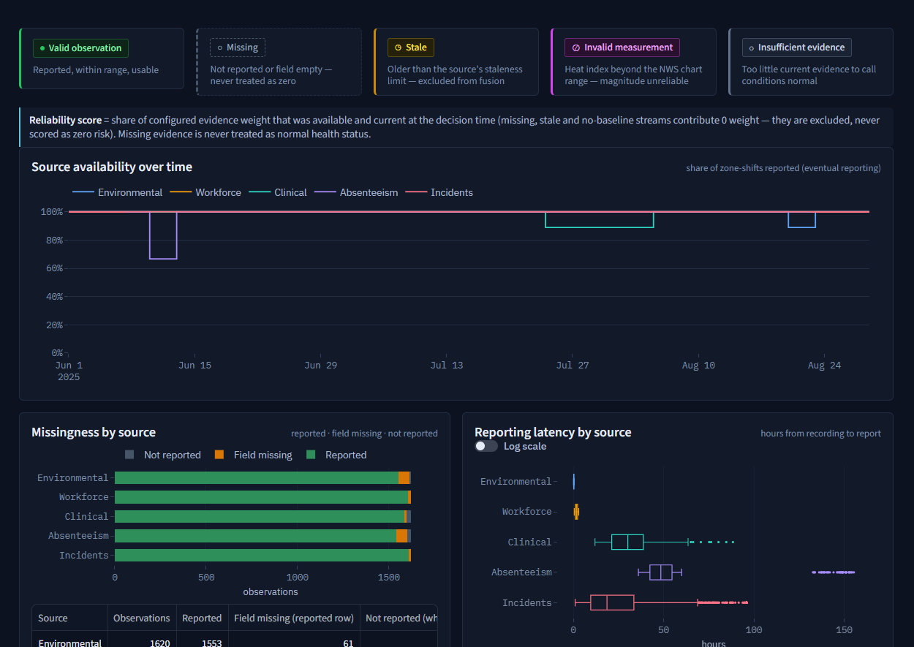
</td>
</tr>
</table>

## How it works

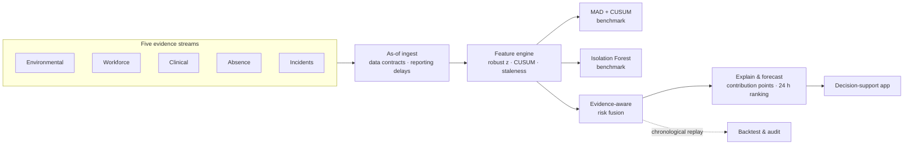

1. **Respect the clock.** Every decision uses only data that had *actually arrived* by that moment — clinic data a day
   late, absence two days late. A chronological replay rebuilds all **1,620 / 1,620** decisions identically.
2. **Compare a zone with itself.** Robust z-scores (median / MAD) and CUSUM against each zone's own recent history, so a
   hot foundry isn't judged like a cool packing hall.
3. **Demand corroboration.** Five 0–100 category scores with weights re-spread over what's available. Heat alone earns
   an *environmental warning*; a *health alert* needs a health signal, corroborated and persistent.
4. **Show the working.** Every assessment lists contributions, observed vs baseline, CUSUM, and missing or stale sources.

### Principles we refuse to bend

- **Missing is never zero.** Unreported data is excluded and named — **0 of 1,358** unavailable readings were ever scored.
- **Evidence before alarm.** Six classes, from *Normal* to *High health risk*, plus *Insufficient evidence*.
- **A forecast is a ranking, not a probability.** Never shown as a percentage, never on a gauge.
- **Flag it, never fix it.** Heat-index readings beyond the NWS chart range stay as recorded, flagged as extrapolated.
- **Privacy by design.** Aggregated zone-shift data only, no individual identifiers, small cells suppressed (k ≥ 5).

## How it performed (synthetic backtest)

Thresholds were fixed **before** evaluation and never tuned on test events.

| Measure | Prevenza risk fusion | MAD + CUSUM baseline |
|---|:---:|:---:|
| False alerts on isolated heat spikes | **0 of 2** | 2 of 2 |
| False alert episodes per site-week | **0.25** | 1.66 |
| Heat events detected | 80 % | **100 %** |
| Median warning before escalation | +5 h | **+95 h** |
| 24 h forecast F1 on the unseen event (vs persistence) | 0.24 | **0.35** |

<div align="center">
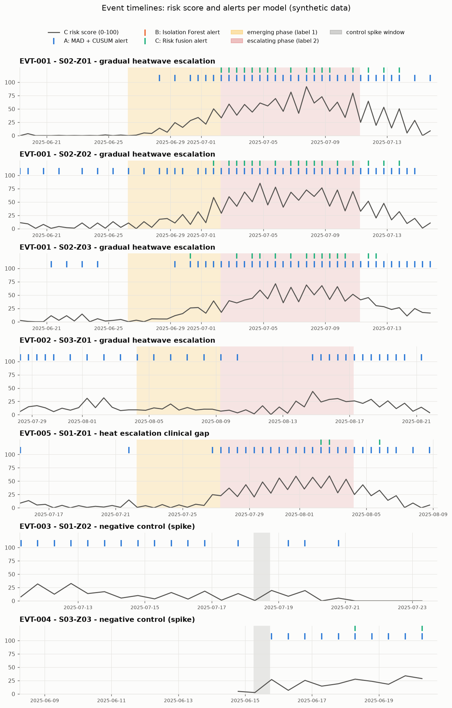
<br><sub>Every simulated event, its emerging and escalating phases, and when each model alerted.</sub>
</div>
<br>
<table>
<tr>
<td width="50%">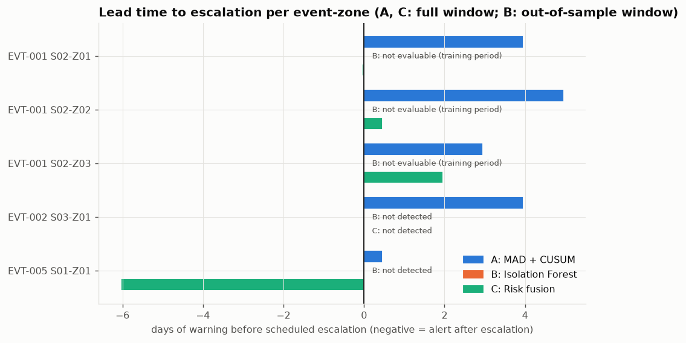<br><sub>Lead time to escalation per event-zone</sub></td>
<td width="50%">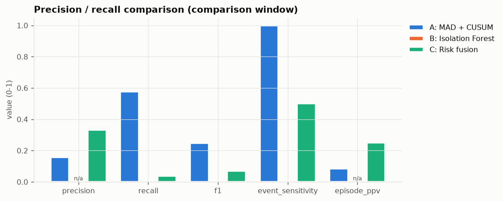<br><sub>Precision / recall comparison (out-of-sample window)</sub></td>
</tr>
<tr>
<td width="50%">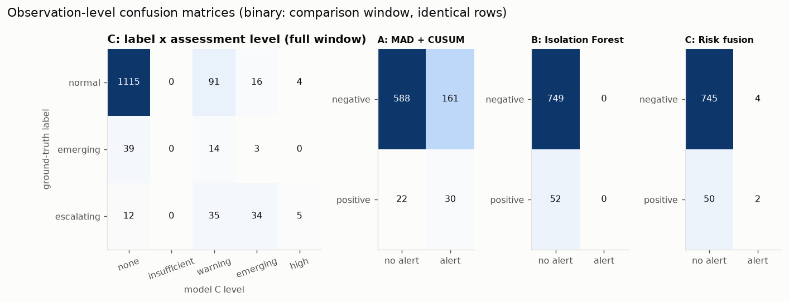<br><sub>Observation-level confusion matrices</sub></td>
<td width="50%">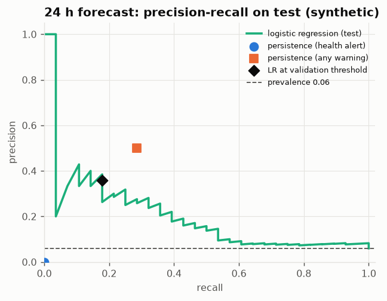<br><sub>24 h forecast vs persistence on held-out data</sub></td>
</tr>
</table>

**Read it honestly:** fusion cuts alert noise by ~85 % and ignores one-off spikes, but it warns later, misses the
radiant-heat foundry event, and the 24-hour forecast shows no gain over simply carrying today's warning forward. Full
detail in [`docs/backtesting_report.md`](docs/backtesting_report.md), [`docs/model_comparison.md`](docs/model_comparison.md)
and the [pre-dashboard audit](docs/pre_dashboard_audit.md).

## Quick start

```powershell
git clone https://github.com/aksh1009/Prevenza.git
cd Prevenza
python -m venv .venv
.venv\Scripts\activate            # macOS/Linux: source .venv/bin/activate
pip install -r requirements.txt
streamlit run app.py              # opens on the Home page
```

The generated data and model outputs are committed, so the app runs immediately. To rebuild everything from scratch:

```powershell
python -m src.data_generation.generate     # 90-day synthetic world + ground truth
python -m src.features.build               # unified observations + as-of features
python -m src.detection.isolation_forest   # benchmark detector (chronological split)
python -m src.detection.risk_fusion        # evidence-aware risk fusion
python -m src.evaluation.backtest          # chronological replay backtest (~3 min)
python -m src.forecasting.forecast         # 24 h forecast vs persistence
python -m src.evaluation.audit             # evaluation-independence audit
python -m pytest -q                        # 264 tests
```

## Repository layout

```
app.py                      Streamlit entry point (read-only)
config/                     simulation, features, models, fusion, backtest, forecast settings (YAML)
src/
  data_generation/          seeded simulator: 3 sites × 9 zones × 2 shifts × 90 days, events & data faults
  preprocessing/            data contracts, loading, one-to-one joins
  features/                 as-of features (robust z, CUSUM, staleness), heat-index validity
  detection/                Isolation Forest, evidence-aware risk fusion
  forecasting/              24 h forecast with persistence baselines
  evaluation/               chronological replay, metrics, charts, audit
  dashboard/                design tokens, components, charts, seven pages
data/                       raw · processed · ground_truth (synthetic)
docs/                       architecture, dictionaries, reports, figures, screenshots
tests/                      264 tests: contracts, leakage, replay, fusion, forecasting, dashboard
```

## Documentation

| Document | Contents |
|---|---|
| [Architecture](docs/architecture.md) | Pipeline, phases, evaluation definitions |
| [Data dictionary](docs/data_dictionary.md) · [Feature dictionary](docs/feature_dictionary.md) | Every field and feature |
| [Risk fusion report](docs/risk_fusion_report.md) | Fusion configuration and class counts |
| [Backtesting report](docs/backtesting_report.md) · [Model comparison](docs/model_comparison.md) | Detection results |
| [Forecast report](docs/forecast_report.md) | 24 h forecasting vs persistence |
| [Pre-dashboard audit](docs/pre_dashboard_audit.md) | Evaluation independence, limitations, measurement validity |
| [Dashboard guide](docs/dashboard.md) | Design system, data separation, page notes |

## Limitations

- One simulated realisation with a handful of events — results describe behaviour, not real-world performance.
- The simulator and detectors were designed by the same team, which likely flatters performance.
- The heat index ignores radiant heat; a radiant-heat zone (the foundry) is under-represented — WBGT sensing is the fix.
- Forecast scores are uncalibrated; real use requires prospective validation on independently labelled data.

## Built with

Python · pandas · NumPy · scikit-learn · Plotly · Streamlit · PyArrow · Matplotlib · pytest · IBM Plex

<div align="center">
<sub><b>Prevenza</b> · Detect early. Understand risk. Prevent harm. · Team Double A</sub>
</div>
