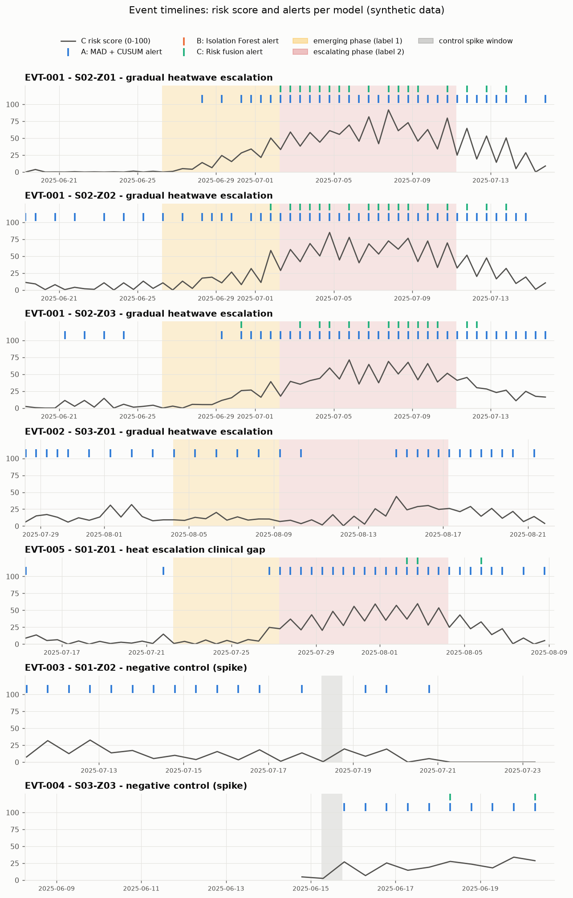
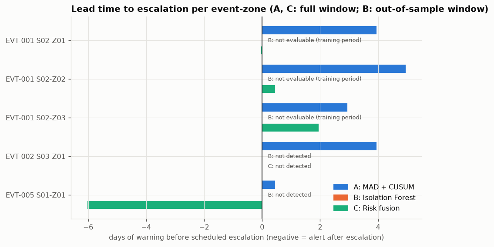
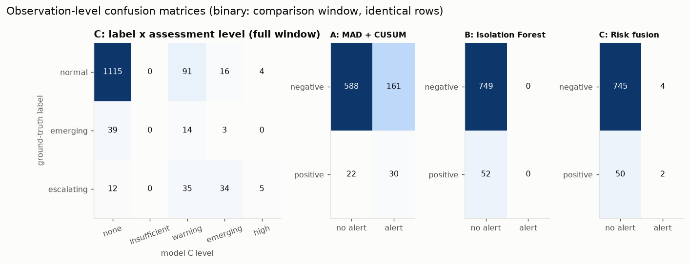
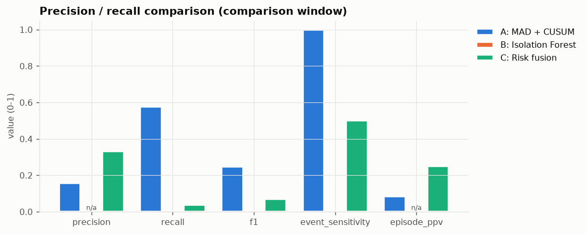
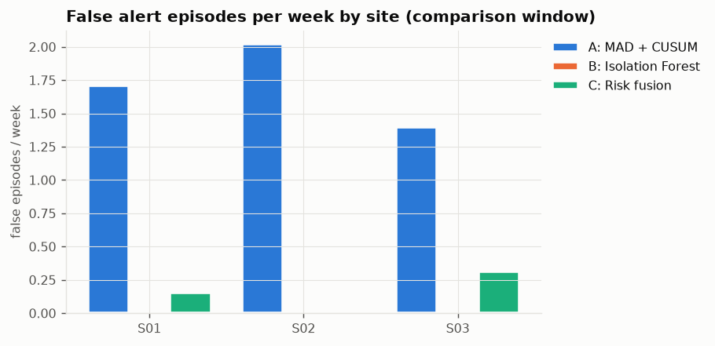
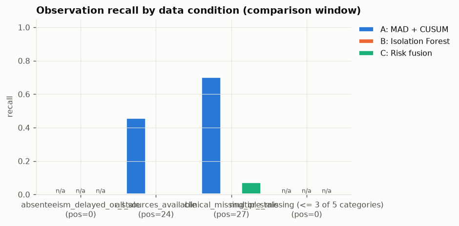
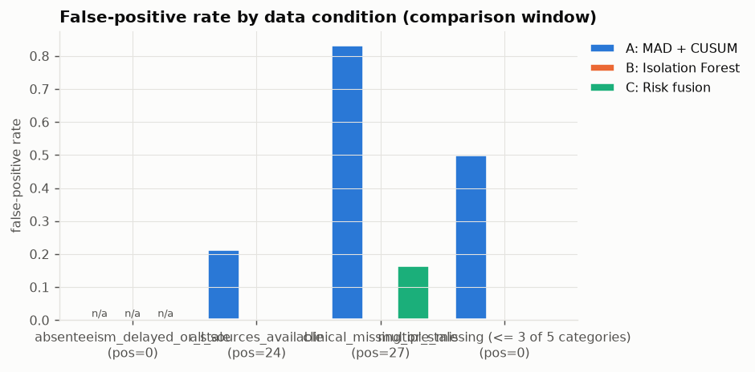

# PREVENZA Backtesting and Operational Validation (Phase 4A)

> GENERATED by `python -m src.evaluation.backtest`. Do not edit by hand.

> **Synthetic validation only.** All results come from a simulated 90-day dataset with injected, known scenarios. They show how the pipeline behaves under those simulated conditions; they are **not** evidence of real-world clinical, epidemiological or operational performance, which would require validation on real, independently labelled data. Thresholds were set before evaluation and were not tuned on these events. Scores are not probabilities and not individual clinical risk.

## 1. Chronological replay

Decision timestamps replayed: **180 of 180** (full replay). At each timestamp the information state contains only source values with `reporting_timestamp <= T`; features, the persisted Isolation Forest and risk fusion are recomputed and only that timestamp's rows kept.

| output | rows replayed | rows identical |
|---|---|---|
| features | 1620 | 1620 |
| isolation_forest | 1620 | 1620 |
| assessments | 1620 | 1620 |

Model versions: Isolation Forest `5b68d340b0a8` (trained on decisions before 2025-07-17 00:00:00), config hash `d951be480738`, raw data hash `4fe359272867`, scikit-learn 1.9.1.

## 2. Definitions

- **Models.** A = any of six signals with robust z >= 5 or CUSUM >= 5 (no fusion). B = Isolation Forest anomaly decision, out-of-sample rows only. C = risk fusion health alert (Emerging or High health risk). C-high = High health risk only; C-warning = Environmental warning / Elevated occupational exposure (not health alerts).
- **Episodes.** Alerting observations of a site-zone (both shifts) with consecutive decisions <= 24 h apart.
- **Matching.** An episode matches an escalating event-zone if its observation span overlaps [onset - 0 h, end + 24 h). Each episode matches at most one event-zone (largest overlap); each event-zone is credited once (later episodes = `matched_duplicate`). Episodes overlapping only a negative-control spike are `control_false_alarm`.
- **Event sensitivity** = detected / included escalating event-zones. **Episode PPV** = non-false episodes / all episodes. **Detection delay** = first alert decision - onset. **Lead time** = escalation - first alert decision (positive = warning before escalation). **Coverage** = share of the event's labelled observations (label 1-2) with an alert.
- **Observation metrics** use label >= 1 as positive; warm-up rows are excluded; ineligible predictions count as no alert (reported as `n_ineligible`). **False alerts per site-week** = false episodes / (sites x weeks in window).

## 3. Evaluation windows

| window | first decision | last decision | observations | models |
|---|---|---|---|---|
| full | 2025-06-15 19:00 | 2025-08-30 07:00 | 1368 | A, C |
| comparison | 2025-07-17 07:00 | 2025-08-30 07:00 | 801 | A, B, C |

## 4. Results - full window (models A and C; no fitted parameters)

| metric | A | C | C-high | C-warning |
|---|---|---|---|---|
| event_zones_included | 5.000 | 5.000 | 5.000 | 5.000 |
| event_zones_detected | 5.000 | 4.000 | 2.000 | 5.000 |
| event_sensitivity | 1.000 | 0.800 | 0.400 | 1.000 |
| detected_before_escalation | 5.000 | 2.000 | 0.000 | 5.000 |
| median_lead_time_to_escalation_hours | 95.000 | 5.000 | -97.000 | 59.000 |
| median_detection_delay_hours | 49.000 | 139.000 | 241.000 | 85.000 |
| mean_detection_coverage | 0.737 | 0.282 | 0.033 | 0.349 |
| controls_included | 2.000 | 2.000 | 2.000 | 2.000 |
| controls_with_false_alert | 2.000 | 0.000 | 0.000 | 2.000 |
| n_episodes | 60.000 | 15.000 | 5.000 | 43.000 |
| episode_ppv | 0.100 | 0.467 | 0.800 | 0.326 |
| false_alarm_episodes | 54.000 | 8.000 | 1.000 | 29.000 |
| false_alerts_per_site_week | 1.658 | 0.246 | 0.031 | 0.890 |
| median_episode_duration_hours | 42.000 | 24.000 | 12.000 | 36.000 |
| precision | 0.228 | 0.677 | 0.556 | 0.350 |
| recall | 0.746 | 0.296 | 0.035 | 0.345 |
| f1 | 0.350 | 0.412 | 0.066 | 0.348 |
| false_positive_rate | 0.292 | 0.016 | 0.003 | 0.074 |
| tp | 106.000 | 42.000 | 5.000 | 49.000 |
| fp | 358.000 | 20.000 | 4.000 | 91.000 |
| fn | 36.000 | 100.000 | 137.000 | 93.000 |
| tn | 868.000 | 1206.000 | 1222.000 | 1135.000 |
| n_ineligible | 0.000 | 0.000 | 0.000 | 0.000 |

## 5. Results by event

| model | event_id | zone_id | role | result | first_alert_decision | detection_delay_hours | lead_time_to_escalation_hours | coverage | n_matched_episodes | n_duplicate_episodes |
|---|---|---|---|---|---|---|---|---|---|---|
| A | EVT-001 | S02-Z01 | escalating_event | detected | 2025-06-28 07:00 | 49.0 | 95.0 | 0.8 | 1.0 | 0.0 |
| C | EVT-001 | S02-Z01 | escalating_event | detected | 2025-07-02 07:00 | 145.0 | -1.0 | 0.5 | 2.0 | 1.0 |
| A | EVT-001 | S02-Z02 | escalating_event | detected | 2025-06-27 07:00 | 25.0 | 119.0 | 0.9 | 1.0 | 0.0 |
| C | EVT-001 | S02-Z02 | escalating_event | detected | 2025-07-01 19:00 | 133.0 | 11.0 | 0.5 | 1.0 | 0.0 |
| A | EVT-001 | S02-Z03 | escalating_event | detected | 2025-06-29 07:00 | 73.0 | 71.0 | 0.8 | 1.0 | 0.0 |
| C | EVT-001 | S02-Z03 | escalating_event | detected | 2025-06-30 07:00 | 97.0 | 47.0 | 0.4 | 3.0 | 2.0 |
| A | EVT-002 | S03-Z01 | escalating_event | detected | 2025-08-05 07:00 | 25.0 | 95.0 | 0.5 | 2.0 | 1.0 |
| C | EVT-002 | S03-Z01 | escalating_event | NOT detected | NaT | NA | NA | 0.0 | 0.0 | 0.0 |
| A | EVT-003 | S01-Z02 | negative_control | false alert on control | NaT | NA | NA | NA | NA | NA |
| C | EVT-003 | S01-Z02 | negative_control | no alert (correct) | NaT | NA | NA | NA | NA | NA |
| A | EVT-004 | S03-Z03 | negative_control | false alert on control | NaT | NA | NA | NA | NA | NA |
| C | EVT-004 | S03-Z03 | negative_control | no alert (correct) | NaT | NA | NA | NA | NA | NA |
| A | EVT-005 | S01-Z01 | escalating_event | detected | 2025-07-26 19:00 | 109.0 | 11.0 | 0.7 | 1.0 | 0.0 |
| C | EVT-005 | S01-Z01 | escalating_event | detected | 2025-08-02 07:00 | 265.0 | -145.0 | 0.1 | 1.0 | 0.0 |

### Scenario summaries

**EVT-001 - Scenario B gradual heatwave, construction site (3 zones)**

- A: MAD + CUSUM (full window): S02-Z01: detected, first alert 06-28 07:00, +4.0 d vs escalation, coverage 83%; S02-Z02: detected, first alert 06-27 07:00, +5.0 d vs escalation, coverage 90%; S02-Z03: detected, first alert 06-29 07:00, +3.0 d vs escalation, coverage 80%
- C: Risk fusion (full window): S02-Z01: detected, first alert 07-02 07:00, -0.0 d vs escalation, coverage 47%; S02-Z02: detected, first alert 07-01 19:00, +0.5 d vs escalation, coverage 47%; S02-Z03: detected, first alert 06-30 07:00, +2.0 d vs escalation, coverage 40%
- A: MAD + CUSUM (comparison window): not evaluable in this window
- B: Isolation Forest (comparison window): not evaluable in this window
- C: Risk fusion (comparison window): not evaluable in this window

**EVT-002 - Scenario B heat build-up, foundry**

- A: MAD + CUSUM (full window): S03-Z01: detected, first alert 08-05 07:00, +4.0 d vs escalation, coverage 46%
- C: Risk fusion (full window): S03-Z01: not detected
- A: MAD + CUSUM (comparison window): S03-Z01: detected, first alert 08-05 07:00, +4.0 d vs escalation, coverage 46%
- B: Isolation Forest (comparison window): S03-Z01: not detected
- C: Risk fusion (comparison window): S03-Z01: not detected

**EVT-003 - Scenario C isolated spike, warehouse (negative control)**

- A: MAD + CUSUM (full window): 2 alert(s) on spike window (false alert)
- C: Risk fusion (full window): 0 alert(s) on spike window (correct: no alert)
- A: MAD + CUSUM (comparison window): 2 alert(s) on spike window (false alert)
- B: Isolation Forest (comparison window): 0 alert(s) on spike window (correct: no alert)
- C: Risk fusion (comparison window): 0 alert(s) on spike window (correct: no alert)

**EVT-004 - Scenario C isolated spike, outdoor yard (negative control)**

- A: MAD + CUSUM (full window): 3 alert(s) on spike window (false alert)
- C: Risk fusion (full window): 0 alert(s) on spike window (correct: no alert)
- A: MAD + CUSUM (comparison window): not evaluable in this window
- B: Isolation Forest (comparison window): not evaluable in this window
- C: Risk fusion (comparison window): not evaluable in this window

**EVT-005 - Scenario D escalation with missing clinical reporting, loading dock**

- A: MAD + CUSUM (full window): S01-Z01: detected, first alert 07-26 19:00, +0.5 d vs escalation, coverage 69%
- C: Risk fusion (full window): S01-Z01: detected, first alert 08-02 07:00, -6.0 d vs escalation, coverage 8%
- A: MAD + CUSUM (comparison window): S01-Z01: detected, first alert 07-26 19:00, +0.5 d vs escalation, coverage 69%
- B: Isolation Forest (comparison window): S01-Z01: not detected
- C: Risk fusion (comparison window): S01-Z01: detected, first alert 08-02 07:00, -6.0 d vs escalation, coverage 8%

## 6. Missing-data conditions (defined from data availability, not labels)

| window | model | data_state | n | positives | recall | precision | false_positive_rate |
|---|---|---|---|---|---|---|---|
| full | A | all_sources_available | 1208 | 71 | 0.634 | 0.120 | 0.291 |
| full | A | clinical_missing_or_stale | 33 | 27 | 0.704 | 0.792 | 0.833 |
| full | A | absenteeism_delayed_or_stale | 42 | 39 | 1.000 | 0.951 | 0.667 |
| full | A | multiple_missing (<= 3 of 5 categories) | 4 | 1 | 1.000 | 0.500 | 0.333 |
| full | C | all_sources_available | 1208 | 71 | 0.197 | 0.452 | 0.015 |
| full | C | clinical_missing_or_stale | 33 | 27 | 0.074 | 0.667 | 0.167 |
| full | C | absenteeism_delayed_or_stale | 42 | 39 | 0.641 | 1.000 | 0.000 |
| full | C | multiple_missing (<= 3 of 5 categories) | 4 | 1 | 0.000 | NA | 0.000 |
| comparison | A | all_sources_available | 713 | 24 | 0.458 | 0.069 | 0.215 |
| comparison | A | clinical_missing_or_stale | 33 | 27 | 0.704 | 0.792 | 0.833 |
| comparison | A | absenteeism_delayed_or_stale | 0 | 0 | NA | NA | NA |
| comparison | A | multiple_missing (<= 3 of 5 categories) | 2 | 0 | NA | 0.000 | 0.500 |
| comparison | B | all_sources_available | 713 | 24 | 0.000 | NA | 0.000 |
| comparison | B | clinical_missing_or_stale | 33 | 27 | 0.000 | NA | 0.000 |
| comparison | B | absenteeism_delayed_or_stale | 0 | 0 | NA | NA | NA |
| comparison | B | multiple_missing (<= 3 of 5 categories) | 2 | 0 | NA | NA | 0.000 |
| comparison | C | all_sources_available | 713 | 24 | 0.000 | 0.000 | 0.004 |
| comparison | C | clinical_missing_or_stale | 33 | 27 | 0.074 | 0.667 | 0.167 |
| comparison | C | absenteeism_delayed_or_stale | 0 | 0 | NA | NA | NA |
| comparison | C | multiple_missing (<= 3 of 5 categories) | 2 | 0 | NA | NA | 0.000 |

Small subsets (few positives) give unstable rates; read `n` and `positives` before the ratios.

## 7. Insufficient baseline (warm-up)

- 252 warm-up observations (first 14 per series) are excluded from all metrics; 0 of them carry a positive label.
- Model A ineligible on 234, Model B on 252; Model C raised 0 health alerts there. C classifications: Insufficient evidence 235, Normal 17.

## 8. Reporting latency, availability and evidence at alerts (full window)

| source | reported share | median delay h | p95 delay h | max delay h |
|---|---|---|---|---|
| environmental_data | 1.00 | 0.28 | 0.47 | 0.50 |
| workforce_data | 1.00 | 1.73 | 2.87 | 3.00 |
| clinical_data | 0.98 | 29.93 | 46.09 | 88.37 |
| absenteeism_data | 1.00 | 48.39 | 59.55 | 155.33 |
| incident_data | 1.00 | 18.80 | 79.19 | 96.00 |

| C health-alert observations | mean available weight | mean reliability | share evidence adequate | mean categories available | all-row mean available weight |
|---|---|---|---|---|---|
| 62 | 0.92 | 91.77 | 1.00 | 4.50 | 0.98 |

## 9. False alerts by site

| model | window | site_id | false_episodes | false_alerts_per_week |
|---|---|---|---|---|
| A | full | S01 | 22 | 2.03 |
| A | full | S02 | 16 | 1.47 |
| A | full | S03 | 16 | 1.47 |
| C | full | S01 | 2 | 0.18 |
| C | full | S02 | 0 | 0.00 |
| C | full | S03 | 6 | 0.55 |
| A | comparison | S01 | 11 | 1.71 |
| A | comparison | S02 | 13 | 2.02 |
| A | comparison | S03 | 9 | 1.40 |
| B | comparison | S01 | 0 | 0.00 |
| B | comparison | S02 | 0 | 0.00 |
| B | comparison | S03 | 0 | 0.00 |
| C | comparison | S01 | 1 | 0.16 |
| C | comparison | S02 | 0 | 0.00 |
| C | comparison | S03 | 2 | 0.31 |

## 10. Figures

## 11. Limitations

- One simulated realisation (seed 42) with 5 escalating event-zones in the full window and 2 in the out-of-sample comparison window: metrics have very wide uncertainty and must not be generalised.
- The simulator and the detectors were designed by the same team; scenario mechanics (lags, heat-strain model) favour signal shapes the features were built to see. Real data will be noisier and less aligned.
- Model B cannot be evaluated before its training cutoff, so EVT-001 and EVT-004 only test A and C.
- Labels follow the injected schedule (onset/escalation), not observed outcomes; 'emerging' observations may legitimately show little signal yet.
