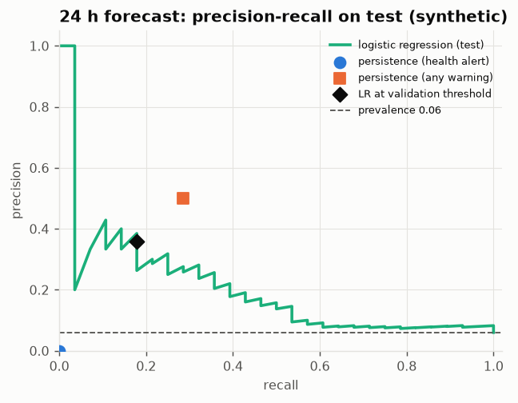

# PREVENZA 24-hour Heat-Risk Forecast (Phase 4B)

> GENERATED by `python -m src.forecasting.forecast`. Do not edit by hand.

> **Synthetic, small-sample results.** The forecaster is trained and tested on one simulated 90-day dataset with three escalating events (five event-zones). Each split contains essentially one event, so metrics describe behaviour on those simulated scenarios only and carry very large uncertainty. Scores are **uncalibrated** (class-weighted logistic regression) - they rank risk; they are not probabilities and not individual clinical risk. No real-world validity is claimed.

## Task

- Target: site-zone in an emerging/escalating labelled state in any observation starting within 24 h after the current shift start (next two shifts, both shift types). Built from future labels for training/evaluation only; rows whose horizon passes the end of data have no target.
- Inputs: the row's own as-of features and risk-fusion outputs at its decision timestamp (replay-verified in Phase 4A). Isolation Forest scores are excluded (in-sample during training). Labels are never inputs.
- Eligibility: post warm-up (14 observations) and fusion available weight >= 0.4; otherwise no forecast is issued.

## Chronological splits

Fractions of dates 0.5/0.2/remainder, fixed a priori; rows whose 24 h target window reaches the next split are purged.

| split | rows | eligible | first_date | last_date | evaluable rows | positive targets | events behind positives |
|---|---|---|---|---|---|---|---|
| purged | 36 | 36 | 2025-07-15 00:00 | 2025-08-02 00:00 | 36 | 2 | EVT-005 |
| test | 486 | 486 | 2025-08-03 00:00 | 2025-08-29 00:00 | 468 | 28 | EVT-002, EVT-005 |
| train | 792 | 540 | 2025-06-01 00:00 | 2025-07-14 00:00 | 540 | 93 | EVT-001 |
| validation | 306 | 306 | 2025-07-16 00:00 | 2025-08-01 00:00 | 306 | 24 | EVT-005 |

## Models

- **Persistence (health alert)**: forecast positive if the current risk-fusion class is Emerging/High health risk.
- **Persistence (any warning)**: forecast positive if the current class is any non-normal warning.
- **Logistic regression**: median imputation + missing-indicators, standardisation, L2 logistic regression with balanced class weights; C selected on validation average precision from [0.01, 0.1, 1.0] -> **C = 0.01**; threshold = max-F1 on validation -> **0.666**; final model refitted on train + validation (846 rows). Version `cbc90f8203b9`.
- **XGBoost: not used.** The training split contains one escalating event (EVT-001, 3 zones of the same site); a boosted-tree model with many interactions would memorise it, and validation has a single event to detect that. A linear model with few inputs is the defensible choice at this sample size.

Validation C grid:

| C | validation_average_precision |
|---|---|
| 0.010 | 0.660 |
| 0.100 | 0.594 |
| 1.000 | 0.522 |

## Results

| split | model | sample | n | positives | tp | fp | fn | precision | recall | f1 | pr_auc | brier |
|---|---|---|---|---|---|---|---|---|---|---|---|---|
| train | persistence (health alert) | no fitting | 540 | 93 | 40 | 16 | 53 | 0.714 | 0.430 | 0.537 | 0.405 | NA |
| train | persistence (any warning) | no fitting | 540 | 93 | 65 | 88 | 28 | 0.425 | 0.699 | 0.528 | 0.349 | NA |
| train | logistic regression | in-sample (fitted on these rows) | 540 | 93 | 68 | 8 | 25 | 0.895 | 0.731 | 0.805 | 0.892 | 0.079 |
| validation | persistence (health alert) | no fitting | 306 | 24 | 1 | 3 | 23 | 0.250 | 0.042 | 0.071 | 0.086 | NA |
| validation | persistence (any warning) | no fitting | 306 | 24 | 14 | 16 | 10 | 0.467 | 0.583 | 0.519 | 0.305 | NA |
| validation | logistic regression | out-of-sample (train-only model used for selection) | 306 | 24 | 14 | 3 | 10 | 0.824 | 0.583 | 0.683 | 0.660 | 0.084 |
| test | persistence (health alert) | no fitting | 468 | 28 | 0 | 1 | 28 | 0.000 | 0.000 | 0.000 | 0.060 | NA |
| test | persistence (any warning) | no fitting | 468 | 28 | 8 | 8 | 20 | 0.500 | 0.286 | 0.364 | 0.186 | NA |
| test | logistic regression | out-of-sample (final model) | 468 | 28 | 5 | 9 | 23 | 0.357 | 0.179 | 0.238 | 0.212 | 0.093 |

PR-AUC = average precision. For persistence (binary flags) it reduces to a single operating point. Brier is shown for the logistic score but, with balanced class weights and no calibration step, it measures an uncalibrated score and should not be read as probability accuracy.

## Test results by site

| model | site_id | n | positives | tp | fp | fn | precision | recall | f1 | pr_auc | brier |
|---|---|---|---|---|---|---|---|---|---|---|---|
| persistence (health alert) | S01 | 156 | 1 | 0 | 1 | 1 | 0.000 | 0.000 | 0.000 | 0.006 | NA |
| persistence (health alert) | S02 | 156 | 0 | 0 | 0 | 0 | NA | NA | NA | NA | NA |
| persistence (health alert) | S03 | 156 | 27 | 0 | 0 | 27 | NA | 0.000 | 0.000 | 0.173 | NA |
| persistence (any warning) | S01 | 156 | 1 | 1 | 2 | 0 | 0.333 | 1.000 | 0.500 | 0.333 | NA |
| persistence (any warning) | S02 | 156 | 0 | 0 | 3 | 0 | 0.000 | NA | 0.000 | NA | NA |
| persistence (any warning) | S03 | 156 | 27 | 7 | 3 | 20 | 0.700 | 0.259 | 0.378 | 0.310 | NA |
| logistic regression | S01 | 156 | 1 | 1 | 6 | 0 | 0.143 | 1.000 | 0.250 | 1.000 | 0.053 |
| logistic regression | S02 | 156 | 0 | 0 | 3 | 0 | 0.000 | NA | 0.000 | NA | 0.113 |
| logistic regression | S03 | 156 | 27 | 4 | 0 | 23 | 1.000 | 0.148 | 0.258 | 0.536 | 0.114 |

## Validation / test results by event

| split | event_id | zones | positive rows | recall persistence (health alert) | recall persistence (any warning) | recall logistic regression | first LR positive forecast | false-positive rate LR | false-positive rate persistence (any) |
|---|---|---|---|---|---|---|---|---|---|
| validation | EVT-005 | S01-Z01 | 24 | 0.042 | 0.583 | 0.583 | 2025-07-26 19:00 | NA | NA |
| validation | (no event: negatives) | all | 0 | NA | NA | NA | NA | 0.011 | 0.057 |
| test | EVT-002 | S03-Z01 | 27 | 0.000 | 0.259 | 0.148 | 2025-08-11 19:00 | NA | NA |
| test | EVT-005 | S01-Z01 | 1 | 0.000 | 1.000 | 1.000 | 2025-08-03 19:00 | NA | NA |
| test | (no event: negatives) | all | 0 | NA | NA | NA | NA | 0.020 | 0.018 |

## Score reliability on test (descriptive, NOT a calibration claim)

| bin | n | mean_score | observed_rate |
|---|---|---|---|
| (-0.001, 0.2] | 259 | 0.099 | 0.042 |
| (0.2, 0.4] | 148 | 0.277 | 0.041 |
| (0.4, 0.6] | 42 | 0.493 | 0.143 |
| (0.6, 0.8] | 11 | 0.682 | 0.182 |
| (0.8, 1.0] | 8 | 0.884 | 0.375 |

Too few test positives exist to fit or validate a calibration map; the table shows why scores must not be read as probabilities.

## Outputs

- `data/processed/forecast_results.parquet` - operational forecasts (no labels): score, flag, threshold, eligibility, missing/stale inputs, limitations text, in-sample flag, `is_latest` per site-zone-shift.
- `data/processed/forecast_evaluation.parquet` - targets + model outputs for evaluation only.
- `models/forecast/` - fitted pipeline (imputer, scaler, model) and metadata (config, features, C, threshold, versions).

## Limitations

- One simulated realisation; ~1 event per split; results can flip with a different seed or split point.
- Targets follow the injected schedule (labels), so 'emerging' periods may have little observable signal.
- Validation threshold transferred to a model refitted on train + validation (standard practice, unverified here).
- Scores are uncalibrated; no claim of probability accuracy is made.
- Real-world use would require prospective validation on real, independently labelled data.
