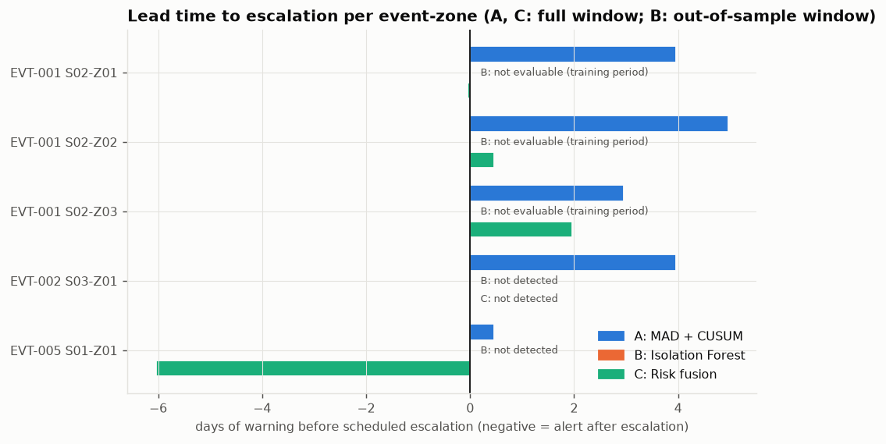
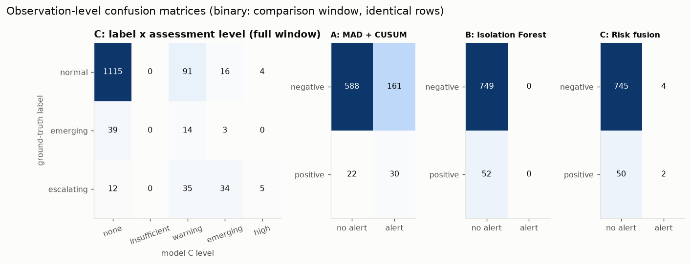
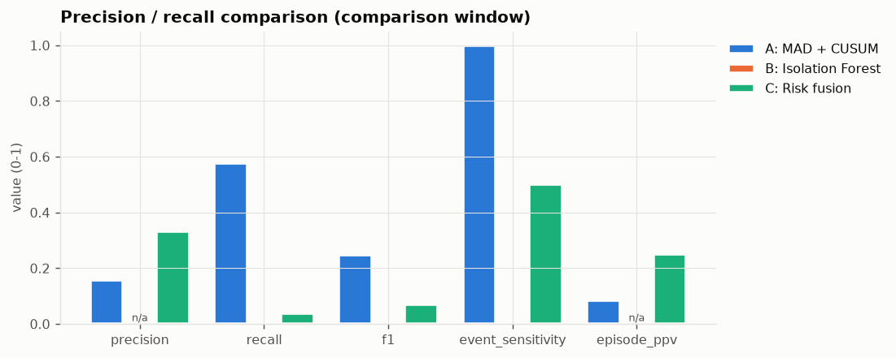
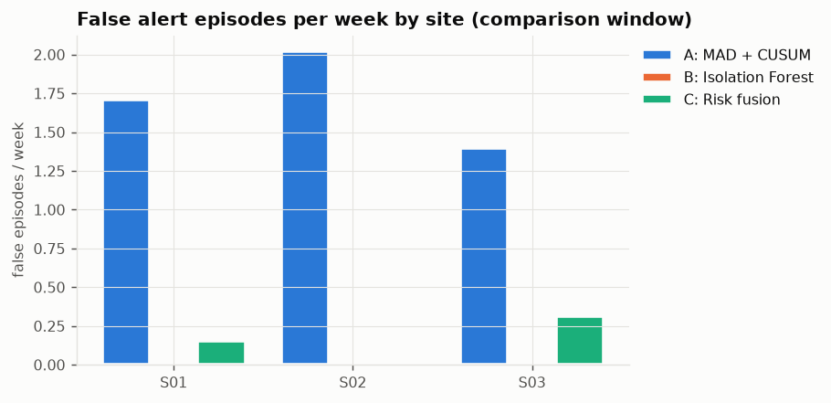
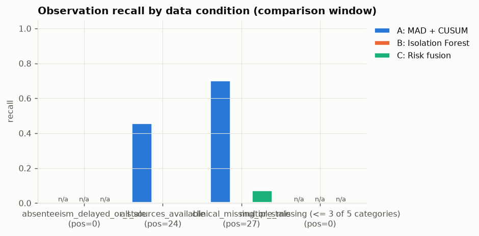
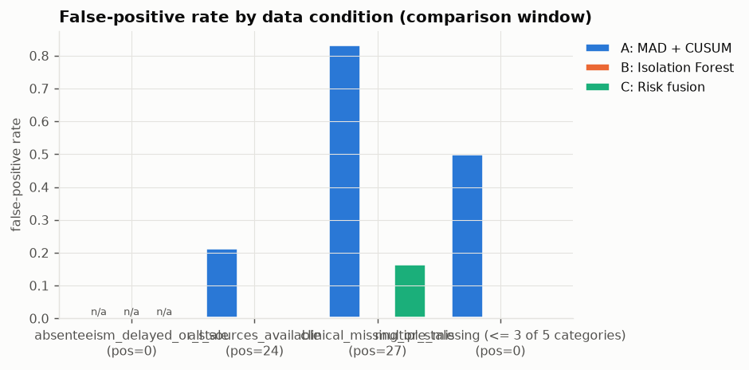

# PREVENZA Model Comparison (Phase 4A)

> GENERATED by `python -m src.evaluation.backtest`. Do not edit by hand.

> **Synthetic validation only.** All results come from a simulated 90-day dataset with injected, known scenarios. They show how the pipeline behaves under those simulated conditions; they are **not** evidence of real-world clinical, epidemiological or operational performance, which would require validation on real, independently labelled data. Thresholds were set before evaluation and were not tuned on these events. Scores are not probabilities and not individual clinical risk.

All three models are scored on the **identical out-of-sample window**: decisions at or after the Isolation Forest training cutoff (2025-07-17 00:00:00), after warm-up. Only valid out-of-sample Isolation Forest predictions are used.

- **A: MAD + CUSUM** - univariate robust z / CUSUM on six signals, any-signal rule.
- **B: Isolation Forest** - multivariate isolation, contamination 0.05 on the training window.
- **C: Risk fusion** - evidence-weighted categories, corroboration + persistence (Emerging/High health risk).

## Headline metrics (comparison window)

| metric | A | B | C |
|---|---|---|---|
| event_zones_included | 2.000 | 2.000 | 2.000 |
| event_zones_detected | 2.000 | 0.000 | 1.000 |
| event_sensitivity | 1.000 | 0.000 | 0.500 |
| detected_before_escalation | 2.000 | 0.000 | 0.000 |
| median_lead_time_to_escalation_hours | 53.000 | NA | -145.000 |
| median_detection_delay_hours | 67.000 | NA | 265.000 |
| mean_detection_coverage | 0.577 | 0.000 | 0.038 |
| controls_included | 1.000 | 1.000 | 1.000 |
| controls_with_false_alert | 1.000 | 0.000 | 0.000 |
| n_episodes | 36.000 | 0.000 | 4.000 |
| episode_ppv | 0.083 | NA | 0.250 |
| false_alarm_episodes | 33.000 | 0.000 | 3.000 |
| false_alerts_per_site_week | 1.711 | 0.000 | 0.156 |
| median_episode_duration_hours | 36.000 | NA | 18.000 |
| precision | 0.157 | NA | 0.333 |
| recall | 0.577 | 0.000 | 0.038 |
| f1 | 0.247 | 0.000 | 0.069 |
| false_positive_rate | 0.215 | 0.000 | 0.005 |
| tp | 30.000 | 0.000 | 2.000 |
| fp | 161.000 | 0.000 | 4.000 |
| fn | 22.000 | 52.000 | 50.000 |
| tn | 588.000 | 749.000 | 745.000 |
| n_ineligible | 0.000 | 0.000 | 0.000 |

## Events in the comparison window

| model | event_id | zone_id | role | result | first_alert_decision | detection_delay_hours | lead_time_to_escalation_hours | coverage | n_matched_episodes | n_duplicate_episodes |
|---|---|---|---|---|---|---|---|---|---|---|
| A | EVT-001 | S02-Z01 | escalating_event | excluded: onset before evaluation window (warm-up/training period) | NaT | NA | NA | NA | NA | NA |
| B | EVT-001 | S02-Z01 | escalating_event | excluded: onset before evaluation window (warm-up/training period) | NaT | NA | NA | NA | NA | NA |
| C | EVT-001 | S02-Z01 | escalating_event | excluded: onset before evaluation window (warm-up/training period) | NaT | NA | NA | NA | NA | NA |
| A | EVT-001 | S02-Z02 | escalating_event | excluded: onset before evaluation window (warm-up/training period) | NaT | NA | NA | NA | NA | NA |
| B | EVT-001 | S02-Z02 | escalating_event | excluded: onset before evaluation window (warm-up/training period) | NaT | NA | NA | NA | NA | NA |
| C | EVT-001 | S02-Z02 | escalating_event | excluded: onset before evaluation window (warm-up/training period) | NaT | NA | NA | NA | NA | NA |
| A | EVT-001 | S02-Z03 | escalating_event | excluded: onset before evaluation window (warm-up/training period) | NaT | NA | NA | NA | NA | NA |
| B | EVT-001 | S02-Z03 | escalating_event | excluded: onset before evaluation window (warm-up/training period) | NaT | NA | NA | NA | NA | NA |
| C | EVT-001 | S02-Z03 | escalating_event | excluded: onset before evaluation window (warm-up/training period) | NaT | NA | NA | NA | NA | NA |
| A | EVT-002 | S03-Z01 | escalating_event | detected | 2025-08-05 07:00 | 25.0 | 95.0 | 0.5 | 2.0 | 1.0 |
| B | EVT-002 | S03-Z01 | escalating_event | NOT detected | NaT | NA | NA | 0.0 | 0.0 | 0.0 |
| C | EVT-002 | S03-Z01 | escalating_event | NOT detected | NaT | NA | NA | 0.0 | 0.0 | 0.0 |
| A | EVT-003 | S01-Z02 | negative_control | false alert on control | NaT | NA | NA | NA | NA | NA |
| B | EVT-003 | S01-Z02 | negative_control | no alert (correct) | NaT | NA | NA | NA | NA | NA |
| C | EVT-003 | S01-Z02 | negative_control | no alert (correct) | NaT | NA | NA | NA | NA | NA |
| A | EVT-004 | S03-Z03 | negative_control | excluded: onset before evaluation window (warm-up/training period) | NaT | NA | NA | NA | NA | NA |
| B | EVT-004 | S03-Z03 | negative_control | excluded: onset before evaluation window (warm-up/training period) | NaT | NA | NA | NA | NA | NA |
| C | EVT-004 | S03-Z03 | negative_control | excluded: onset before evaluation window (warm-up/training period) | NaT | NA | NA | NA | NA | NA |
| A | EVT-005 | S01-Z01 | escalating_event | detected | 2025-07-26 19:00 | 109.0 | 11.0 | 0.7 | 1.0 | 0.0 |
| B | EVT-005 | S01-Z01 | escalating_event | NOT detected | NaT | NA | NA | 0.0 | 0.0 | 0.0 |
| C | EVT-005 | S01-Z01 | escalating_event | detected | 2025-08-02 07:00 | 265.0 | -145.0 | 0.1 | 1.0 | 0.0 |

## False alerts by site (comparison window)

| model | window | site_id | false_episodes | false_alerts_per_week |
|---|---|---|---|---|
| A | comparison | S01 | 11 | 1.71 |
| A | comparison | S02 | 13 | 2.02 |
| A | comparison | S03 | 9 | 1.40 |
| B | comparison | S01 | 0 | 0.00 |
| B | comparison | S02 | 0 | 0.00 |
| B | comparison | S03 | 0 | 0.00 |
| C | comparison | S01 | 1 | 0.16 |
| C | comparison | S02 | 0 | 0.00 |
| C | comparison | S03 | 2 | 0.31 |

## Missing-data conditions (comparison window)

| window | model | data_state | n | positives | recall | precision | false_positive_rate |
|---|---|---|---|---|---|---|---|
| comparison | A | all_sources_available | 713 | 24 | 0.458 | 0.069 | 0.215 |
| comparison | A | clinical_missing_or_stale | 33 | 27 | 0.704 | 0.792 | 0.833 |
| comparison | A | absenteeism_delayed_or_stale | 0 | 0 | NA | NA | NA |
| comparison | A | multiple_missing (<= 3 of 5 categories) | 2 | 0 | NA | 0.000 | 0.500 |
| comparison | B | all_sources_available | 713 | 24 | 0.000 | NA | 0.000 |
| comparison | B | clinical_missing_or_stale | 33 | 27 | 0.000 | NA | 0.000 |
| comparison | B | absenteeism_delayed_or_stale | 0 | 0 | NA | NA | NA |
| comparison | B | multiple_missing (<= 3 of 5 categories) | 2 | 0 | NA | NA | 0.000 |
| comparison | C | all_sources_available | 713 | 24 | 0.000 | 0.000 | 0.004 |
| comparison | C | clinical_missing_or_stale | 33 | 27 | 0.074 | 0.667 | 0.167 |
| comparison | C | absenteeism_delayed_or_stale | 0 | 0 | NA | NA | NA |
| comparison | C | multiple_missing (<= 3 of 5 categories) | 2 | 0 | NA | NA | 0.000 |

## Figures

## Reading the comparison

- The comparison window contains only 2 escalating event-zones and 1 negative control; differences of one event change sensitivity by 50 percentage points.
- Observation-level recall rewards alerting on every labelled shift; event-level metrics reward early, single detections. Read both.
- These are synthetic results and do not establish real-world superiority of any model.
